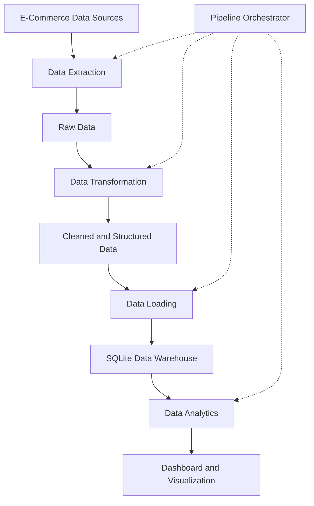

# E-Commerce Data Warehouse & ETL Analytics System

**An end-to-end Python-based data engineering project that simulates e-commerce data extraction, transformation, loading, storage, and analytical reporting.**

## 1. Project Overview

The E-Commerce Data Warehouse & ETL Analytics System is a Python-based data engineering project designed to demonstrate how e-commerce data can be collected, processed, stored, and analyzed through an automated ETL (Extract, Transform, Load) pipeline.

The project simulates e-commerce data workflows inspired by platforms such as Amazon and Flipkart. It demonstrates how raw product information can be extracted from available web data sources, transformed into a structured format, stored in a centralized SQLite database, and used to generate analytical insights and visualizations.

The system follows a modular architecture that separates data extraction, transformation, database loading, analytics, and dashboard generation.

The primary objective is to demonstrate practical data engineering concepts through a structured and extensible implementation.

## 2. Problem Statement

E-commerce platforms generate large amounts of product and business data. However, raw data collected from different sources may contain:

- Inconsistent data formats.
- Missing or incomplete values.
- Duplicate records.
- Unstructured product information.
- Inconsistent product attributes.
- Data that is difficult to analyze directly.

Without a structured data processing workflow, transforming raw information into meaningful business insights becomes difficult.

This project addresses these challenges by implementing an ETL-based data warehouse workflow that organizes raw data, applies transformations, stores structured records, and supports analytical operations.

## 3. Project Objectives

- Develop a modular ETL pipeline using Python.
- Simulate e-commerce data extraction from multiple sources.
- Clean and transform raw datasets.
- Handle missing values and inconsistent records.
- Store structured data in an SQLite database.
- Organize database schemas for analytical operations.
- Generate useful business insights from processed data.
- Visualize analytical results through a dashboard.
- Maintain a modular architecture that can be extended with additional data sources and analytical features.

## 4. Key Features

### Data Extraction
- Collect product-related information from configured data sources.
- Use Python-based web extraction techniques.
- Support structured CSV data as an input/output format.
- Organize extracted records for downstream processing.

### Data Transformation
- Clean raw datasets.
- Handle missing and inconsistent values.
- Standardize data formats.
- Prepare structured datasets for database storage.

### Data Loading
- Store processed records in an SQLite database.
- Use SQLAlchemy for database interaction.
- Organize data using a defined database schema.
- Maintain a structured data loading workflow.

### Data Analytics
- Analyze processed e-commerce datasets.
- Generate useful summaries and statistical insights.
- Support analytical queries on stored data.

### Dashboard and Visualization
- Present analytical information in a visual format.
- Provide an overview of processed data.
- Help users understand trends and patterns in the available dataset.

### Pipeline Orchestration
- Coordinate the extraction, transformation, loading, and analytics modules.
- Maintain separation of responsibilities across different components.
- Simplify execution of the overall workflow.

## 5. Technology Stack

| Technology | Purpose |
|---|---|
| Python | Core programming language |
| Requests | HTTP requests and data retrieval |
| BeautifulSoup | HTML parsing and web extraction |
| Pandas | Data processing and transformation |
| SQLAlchemy | Database interaction |
| SQLite | Relational data storage |
| CSV | Structured data exchange |
| Matplotlib / Visualization library | Use the actual library implemented for charts |

## 6. System Architecture

The project follows a modular ETL architecture.

### ETL Workflow



### Architecture Components

**1. Data Sources**

Provide the raw product-related information used by the ETL pipeline.

**2. Extraction Layer**

Collects information and prepares raw records for further processing.

**3. Transformation Layer**

Cleans, standardizes, and structures the extracted data.

**4. Loading Layer**

Stores the transformed records in the SQLite database.

**5. Analytics Layer**

Processes stored data to generate analytical insights.

**6. Visualization Layer**

Presents the analytical results through a dashboard.

**7. Orchestration Layer**

Coordinates the execution of the different ETL components.

## 7. Project Structure

The project is organized into separate Python modules to improve readability, maintainability, and extensibility.

```text
Data-warehouse-management-system/
│
├── schema.py
│
├── data_extractor.py
│
├── data_transformer.py
│
├── data_loader.py
│
├── analytics.py
│
├── dashboard.py
│
├── orchestrator.py
│
├── data/
│   ├── raw/
│   └── processed/
│
├── database/
│
├── requirements.txt
│
├── README.md
│
└── .gitignore
```

*Note: Update this tree to match the actual directories and filenames in the repository before publishing.*

### Module Responsibilities

| Module | Responsibility |
|---|---|
| `schema.py` | Defines database schema and data structure |
| `data_extractor.py` | Handles data extraction |
| `data_transformer.py` | Cleans and transforms extracted data |
| `data_loader.py` | Loads processed records into SQLite |
| `analytics.py` | Performs analytical operations |
| `dashboard.py` | Handles analytical visualization |
| `orchestrator.py` | Coordinates the complete ETL workflow |

## 8. Installation and Setup

### Prerequisites

Make sure the following tools are installed:

- Python 3.9 or later (verify compatibility with your dependencies).
- Git.
- pip (Python package manager).

### Step 1: Clone the Repository

```bash
git clone https://github.com/SACHIN78957/Data-warehouse-management-system.git
```

Navigate into the project directory:

```bash
cd Data-warehouse-management-system
```

### Step 2: Create a Virtual Environment

```bash
python -m venv venv
```

Activate it on Windows:

```bash
venv\Scripts\activate
```

Activate it on Linux/macOS:

```bash
source venv/bin/activate
```

### Step 3: Install Dependencies

```bash
pip install -r requirements.txt
```

If the requirements file is not yet available, install the dependencies used by the project:

```bash
pip install requests beautifulsoup4 pandas sqlalchemy
```

Install any additional visualization or dashboard dependencies required by your implementation.

### Step 4: Configure the Project

Check the project configuration and ensure that:

- Data source settings are correctly configured.
- Input and output directories exist.
- Database paths are valid.
- Required dependencies are installed.

### Step 5: Run the ETL Pipeline

The main orchestration module coordinates the ETL workflow.

```bash
python orchestrator.py
```

Use this command if `orchestrator.py` is configured as the executable entry point. Otherwise, replace it with the actual execution command.

### Step 6: Run the Dashboard

```bash
python dashboard.py
```

Use the dashboard framework's actual launch command if it requires a separate command-line interface.

## 9. Sample Data and Expected Workflow

The project uses simulated e-commerce product data to demonstrate the ETL process.

### Example Input Data

The following is an illustrative sample, not a claim about the exact columns in the existing dataset.

| Product ID | Product Name | Price | Category |
|---|---|---:|---|
| P101 | Wireless Mouse | 599 | Electronics |
| P102 | Mechanical Keyboard | 1499 | Electronics |
| P103 | Running Shoes | 1999 | Fashion |
| P104 | USB Cable | 199 | Electronics |

### Expected ETL Processing

| Stage | Expected Operation |
|---|---|
| Extract | Collect product records |
| Transform | Clean and standardize records |
| Load | Store structured records in SQLite |
| Analyze | Calculate product and category summaries |
| Visualize | Present analytical results |

### Example Analytical Questions

The processed dataset can be used to explore questions such as:

- Which product categories contain the most products?
- What is the average product price?
- Which products have the highest listed prices?
- How are products distributed across categories?
- Are there missing or duplicate product records?

Actual analytical outputs depend on the available dataset and implemented queries.

## 10. Screenshots and Demonstration

Screenshots will help developers understand the actual execution and output of the project.

Add your genuine screenshots in a `docs/screenshots/` directory.

Recommended screenshots:

| Screenshot | What it should demonstrate |
|---|---|
| `etl_execution.png` | Successful ETL pipeline execution |
| `database_output.png` | Data stored in SQLite |
| `transformation_output.png` | Cleaned dataset |
| `analytics_output.png` | Analytical results |
| `dashboard.png` | Actual dashboard interface |

Example Markdown:

```markdown
### ETL Pipeline Execution


### Database Output


### Analytics Dashboard


```

Only include screenshots of features that have actually been implemented and tested.

## 11. Future Improvements

The project can be extended through the following improvements:

- Support for additional e-commerce data sources.
- Improved data validation and quality checks.
- Automated duplicate detection.
- Incremental data loading.
- Improved database indexing and query performance.
- Automated ETL testing.
- GitHub Actions for continuous integration.
- Enhanced analytical dashboards.
- Better error handling and logging.
- Comprehensive developer documentation.

These are proposed improvements, not claims of currently implemented functionality.

## 12. Contributing

Contributions, suggestions, and bug reports are welcome.

If you would like to contribute:

1. Fork the repository.
2. Create a new feature branch.
3. Make your changes.
4. Test your implementation.
5. Commit your changes with a meaningful message.
6. Open a pull request describing your contribution.

Please ensure that contributions are relevant to the project's objectives and maintain its modular structure.

## 13. Issues and Feature Requests

If you identify a bug or have an idea for improving the project, please open an issue in the GitHub repository.

When reporting an issue, include:

- A clear description of the problem.
- Steps to reproduce it.
- Expected behavior.
- Actual behavior.
- Relevant error messages or screenshots.

## 14. License

This project is intended to be distributed as open-source software.

The repository's license should specify the permissions and conditions for using, modifying, and distributing the code. Refer to the `LICENSE` file for the applicable terms.

## 15. Project Maintainer

**Maintained by:** Sachin Lakheda

GitHub: [@SACHIN78957](https://github.com/SACHIN78957/)

Repository: [Data-warehouse-management-system](https://github.com/SACHIN78957/Data-warehouse-management-system)

---

**Building structured data pipelines, transforming raw information into meaningful insights, and exploring practical data engineering concepts through Python.**
